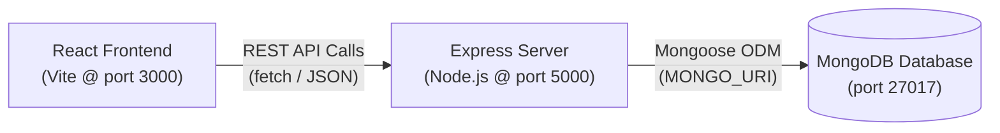
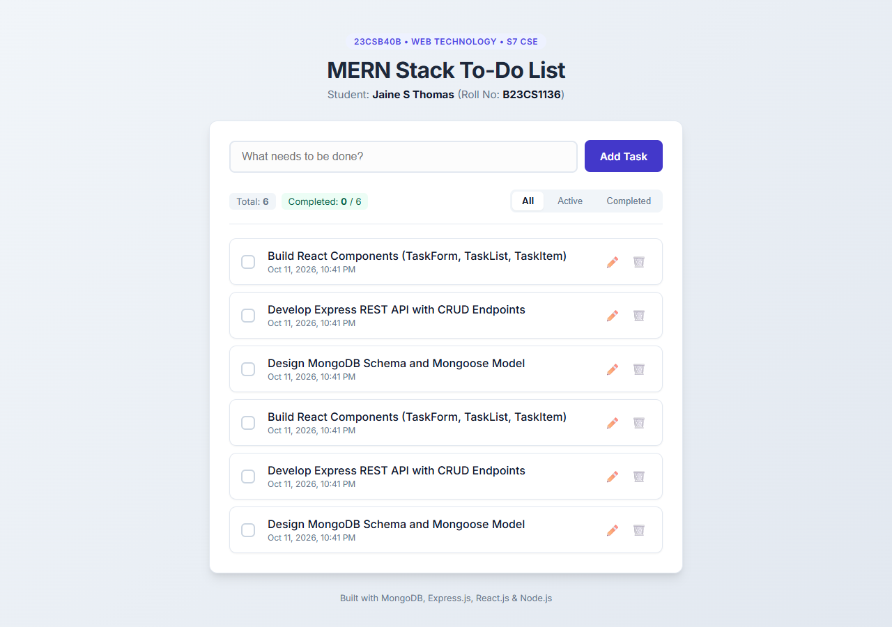
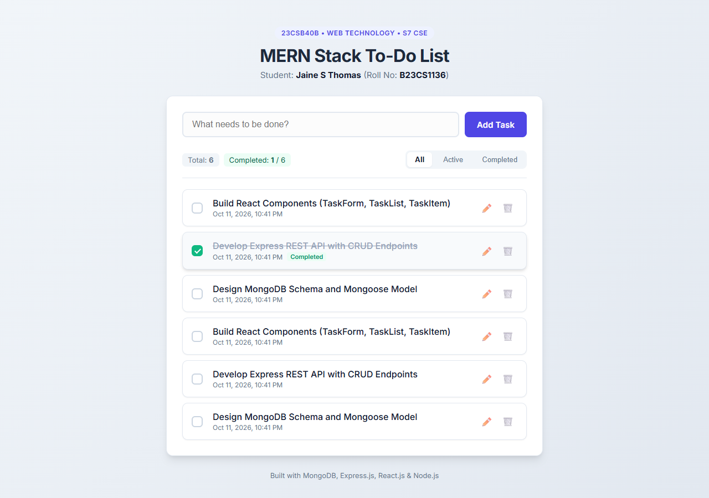
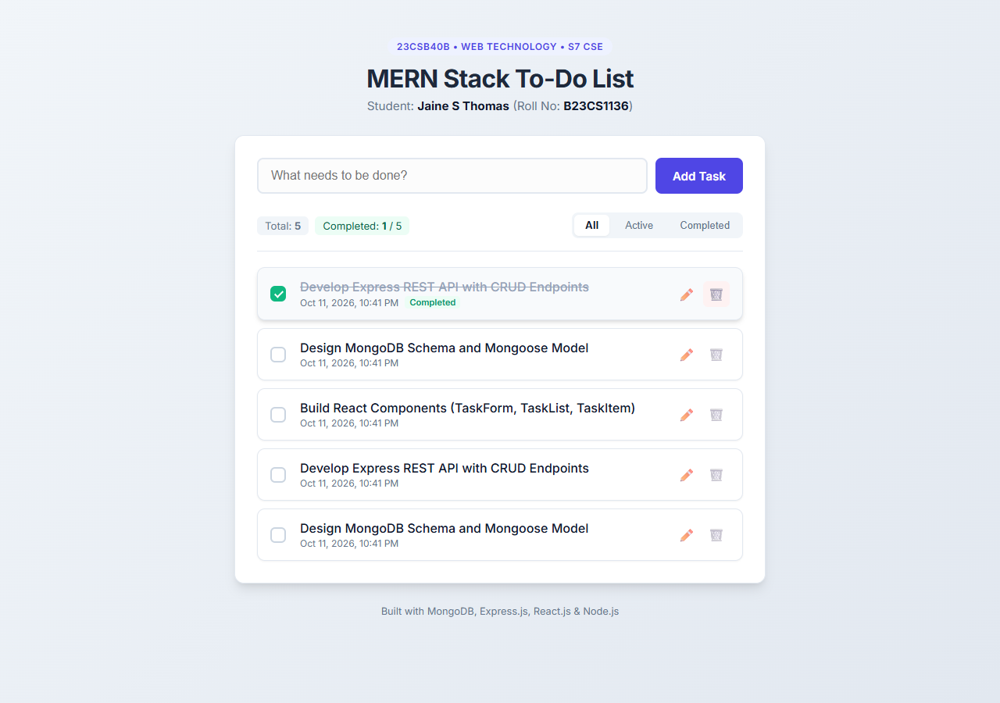
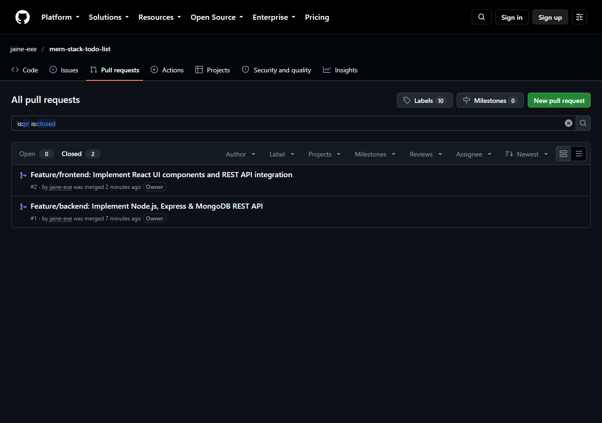

# MERN Stack To-Do List Application

**MAR BASELIOS COLLEGE OF ENGINEERING AND TECHNOLOGY**  
Department of Computer Science and Engineering  
**Course**: 23CSB40B — Web Technology | S7 CSE  
**Assignment**: Assignment 2 — MERN Stack To-Do List Application  
**Student Name**: Jaine S Thomas  
**Roll Number**: B23CS1136  
**GitHub Repository**: [https://github.com/jaine-exe/mern-stack-todo-list](https://github.com/jaine-exe/mern-stack-todo-list)  

---

## 1. Project Overview

A full-stack To-Do List web application designed and developed using the **MERN** stack (**M**ongoDB, **E**xpress.js, **R**eact.js, and **N**ode.js). The frontend, backend, and database are completely connected, allowing persistent task creation, retrieval, updates (completion toggle and title editing), and deletion. 

The application is built following industry best practices:
- **Separation of Concerns**: Modular backend architecture (controllers/routes, models, configuration) and React component hierarchy (`TaskForm`, `TaskList`, `TaskItem`).
- **Data Validation**: Strict server-side and client-side validation rejecting empty or whitespace-only titles with `400 Bad Request`.
- **Security & Secret Hygiene**: Environment variables managed via `.env` with a committed `.env.example` template; `.env` and `node_modules` are completely excluded from Git via `.gitignore`.
- **CORS Protection**: Access restricted specifically to the frontend's address (`http://localhost:3000`).
- **Git Branching Workflow**: Developed using dedicated feature branches (`feature/backend` and `feature/frontend`), integrated into `main` strictly through merged Pull Requests.

---

## 2. Architecture & Tech Stack



| Layer | Technology | Role |
| :--- | :--- | :--- |
| **Frontend** | React 18, Vite, CSS3 | Single-page UI with state management (`useState`, `useEffect`), reactive DOM updates, and custom styling |
| **Backend** | Node.js, Express.js | RESTful API server handling routes, middleware, request validation, and HTTP status codes |
| **Database** | MongoDB, Mongoose | NoSQL database storing task documents matching the Task schema |
| **Version Control** | Git & GitHub | Feature branching (`feature/backend`, `feature/frontend`), atomic commits, and Pull Request integration |

---

## 3. Project File Structure

```text
MERN Stack To-Do List Application/
├── .env.example                     # Root environment variable template
├── .gitignore                       # Excludes node_modules, .env, and build artifacts
├── README.md                        # Project documentation and guide
├── backend/
│   ├── .env                         # Server environment variables (ignored by Git)
│   ├── .env.example                 # Backend environment variable template
│   ├── package.json                 # Backend dependencies and scripts
│   ├── package-lock.json
│   ├── server.js                    # Express application entry point & CORS configuration
│   ├── config/
│   │   └── db.js                    # Mongoose database connection setup
│   ├── models/
│   │   └── Task.js                  # Mongoose Schema and Model for Task
│   └── routes/
│       └── taskRoutes.js            # REST API endpoints (GET, POST, PUT, DELETE)
├── frontend/
│   ├── index.html                   # HTML entry point with Google Fonts
│   ├── package.json                 # Frontend dependencies and scripts
│   ├── package-lock.json
│   ├── vite.config.js               # Vite build configuration (port 3000)
│   └── src/
│       ├── main.jsx                 # React root renderer
│       ├── App.jsx                  # Main application component & API state orchestration
│       ├── App.css                  # UI component styles & responsive layouts
│       ├── index.css                # Global stylesheet & design tokens
│       └── components/
│           ├── TaskForm.jsx         # Task creation form with trim validation
│           ├── TaskList.jsx         # Task list renderer with empty-state views
│           └── TaskItem.jsx         # Task item with complete checkbox, edit, and delete
└── screenshots/
    ├── 01_task_added.png            # Screenshot: Adding tasks
    ├── 02_task_completed.png        # Screenshot: Completed task with strike-through
    ├── 03_task_deleted.png          # Screenshot: Task deletion & real-time counter update
    └── 04_merged_pull_requests.png  # Screenshot: GitHub repository closed/merged PRs
```

---

## 4. REST API Specification

Base URL: `http://localhost:5000/api/tasks`

| Method | Endpoint | Description | Request Body | Success Code | Error Codes |
| :--- | :--- | :--- | :--- | :--- | :--- |
| **GET** | `/api/tasks` | Fetch all tasks (sorted newest first) | None | `200 OK` | `500 Internal Server Error` |
| **POST** | `/api/tasks` | Create a new task | `{ "title": "String" }` | `201 Created` | `400 Bad Request` (empty/invalid title), `500` |
| **PUT** | `/api/tasks/:id` | Update task completion or edit title | `{ "completed": true }` or `{ "title": "New Title" }` | `200 OK` | `400 Bad Request` (empty title), `404 Not Found`, `500` |
| **DELETE** | `/api/tasks/:id` | Delete a task | None | `200 OK` | `404 Not Found`, `500` |

### Input Validation & CORS Policies
- **Title Validation (A5)**: In both `POST` and `PUT` routes, the title is converted using `String()`, trimmed of whitespace, and verified. If the resulting string is empty, the server rejects the request with HTTP `400 Bad Request` and an explanatory JSON error message.
- **Restricted CORS (A6)**: The Express backend explicitly configures `cors({ origin: 'http://localhost:3000' })` so that only the designated frontend client can communicate with the API.

---

## 5. Prerequisites & Environment Setup

### Prerequisites
- **Node.js**: v18.0.0 or higher (Tested on v22.12.0)
- **npm**: v9.0.0 or higher
- **MongoDB**: Local MongoDB instance running on `localhost:27017` OR a MongoDB Atlas cluster URI.

### Environment Variables
Copy `.env.example` to `.env` inside the `backend/` directory:

```bash
# In the backend directory:
cp .env.example .env
```

Contents of `backend/.env`:
```env
PORT=5000
MONGO_URI=mongodb://127.0.0.1:27017/mern_todo_db
CLIENT_ORIGIN=http://localhost:3000
```

---

## 6. How to Run the Application

### 1. Start MongoDB
Ensure MongoDB is running locally:
```bash
# Windows (Services)
net start MongoDB
```
*(If using MongoDB Atlas, simply provide your connection string in `backend/.env`)*

### 2. Start the Backend Server
Open a terminal and navigate to the `backend` directory:
```bash
cd backend
npm install
npm start
```
The backend server will start on `http://localhost:5000` and output:
```text
Server running on port 5000
MongoDB Connected: 127.0.0.1
```
*(For development with live reloading, you can run `npm run dev`)*

### 3. Start the Frontend Application
Open a second terminal and navigate to the `frontend` directory:
```bash
cd frontend
npm install
npm start
```
The React frontend application will launch on `http://localhost:3000`. Open your browser and navigate to:
```
http://localhost:3000
```

---

## 7. Git Workflow & Integration

As required by the assignment guidelines:
1. **Repository Setup**: Initialized with `.gitignore`, `.env.example`, and clean directory structure on `main`.
2. **Feature Branch: `feature/backend`**:
   - `Setup Express server and MongoDB connection`
   - `Add Task model with Mongoose schema`
   - `Add GET and POST API endpoints with input validation`
   - `Add PUT and DELETE endpoints with 404 and validation handling`
   - Pushed to GitHub and integrated into `main` via **Pull Request #1**.
3. **Feature Branch: `feature/frontend`**:
   - `Initialize React frontend application with Vite`
   - `Add TaskForm, TaskList, and TaskItem React components`
   - `Implement App component with REST API integration and state management`
   - `Add responsive styling and visual indicators for tasks`
   - Pushed to GitHub and integrated into `main` via **Pull Request #2**.
4. **Pull Requests Merged**: Both feature branches were merged into `main` without committing features directly to `main`.

---

## 8. Application Screenshots

### 1. Adding Tasks
Tasks created and rendered in real-time without page reload.


### 2. Marking a Task Complete
Task completion toggled via `PUT` endpoint; completed tasks feature strikethrough styling, badge, and updated counter.


### 3. Deleting a Task
Task deleted via `DELETE` endpoint; removed dynamically from UI and database.


### 4. Merged Pull Requests on GitHub
Repository's Pull requests &rarr; Closed tab displaying merged `feature/backend` and `feature/frontend` branches.

